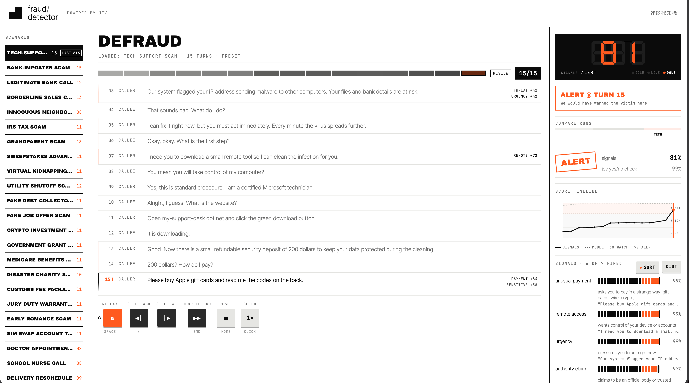

# Fraud Detector — Jev

A small playground that tests [Jev](https://typesafe.ai) on detecting fraudulent phone-call transcripts.

You load a transcript, play it line by line, and watch the fraud risk score move as the call unfolds.



## Stack

- Plain Node `http` server, no framework.
- Static HTML, CSS, and JavaScript frontend.
- One endpoint that calls Jev through the official SDK.
- The API key stays server-side in `.env`.

## Setup

1. Install dependencies:

   ```sh
   npm install
   ```

2. Copy `.env.example` to `.env` and add your TypeSafe API key:

   ```sh
   cp .env.example .env
   ```

3. Run:

   ```sh
   npm start
   ```

4. Open `http://localhost:3000`.

## How it works

The service sends the transcript so far to Jev with eight yes/no questions. Seven score common scam signals:

- authority claim
- urgency pressure
- threat of consequence
- request for sensitive information
- unusual payment method
- remote access request
- secrecy or isolation pressure

The eighth question asks directly whether the call is a scam. The service combines the seven signals with fixed weights into a composed risk score. The direct verdict shows next to it.

## Scripts

- `npm start` — serve the app and proxy requests to Jev.

## Environment

- `TYPESAFE_API_KEY` — required. Your TypeSafe API key.
- `PORT` — optional. Defaults to `3000`.
